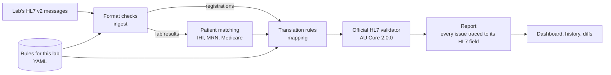

# AU Core Gateway

[](https://github.com/dylandchand/au-core-gateway/actions/workflows/ci.yml)
[](https://github.com/dylandchand/au-core-gateway/actions/workflows/full-validation.yml)

Translates the HL7 v2 messages a pathology lab sends into Australia's national FHIR standard,
**AU Core 2.0.0**, has the **official HL7 FHIR validator** check every record, files every lab
result against the right patient, and traces every problem back to the exact field in the lab's
original message. A seeded fault injector breaks 250 messages in ten realistic ways, and the
gateway must find every one at the field that was changed.

In August 2026 the Australian Digital Health Agency announced AU Core (with AU CDI) as the
mandated national baseline for FHIR connections to My Health Record, with CDA-based connections
to be retired by 2029 ([Medical Republic](https://medicalrepublic.com.au/adha-to-mandate-national-interoperability-standards-for-my-health-record/128099),
[AJP](https://ajp.com.au/news/national-interoperability-baseline-for-digital-health/)). Most
clinical systems still send HL7 v2. This project answers the question every vendor now has:
*what does our data look like in AU Core, does it pass, and if not, exactly what is wrong and
where?*

All data is synthetic: no real patient data is used. Identifiers are generated at random in the real
format, so a number may match a real person's by chance, but it is never linked to that person.
Do not run real patient data through this project. See [Data, licences and trademarks](#data-licences-and-trademarks).

**[Live dashboard](https://dylandchand.github.io/au-core-gateway/)** · **[Message Inspector](https://dylandchand.github.io/au-core-gateway/inspector/)** · **[Interface Monitor](https://dylandchand.github.io/au-core-gateway/monitor/)** · **[Project write-up](docs/WRITEUP.md)** · **[Latest release](https://github.com/dylandchand/au-core-gateway/releases/latest)**

## Results

Measured in CI on every push, on the real HL7 packages, over a seeded population of 1,156
synthetic Queensland patients:

| | |
| --- | --- |
| Patient registrations that conform to AU Core | **1,156 of 1,156** |
| Lab reports filed against the right patient | **16,033 of 16,033** |
| Test results translated into AU Core Observations | **384,727**, all of which pass the official validator (every kind checked on every push, every one weekly) |
| Planted mistakes found at the exact field | **250 of 250** (10 kinds × 25) |
| False alarms on untouched records / findings outside the changed field | **0 / 0** |
| Time for the whole population | 25 s reading and translating, 71 s validating |

```
$ python -m gateway run data/synthea-1000/adt data/synthea-1000/oru
Files: 24   records: 17189   passed: 17189   failed: 0
Patients:     1156/1156 conform to AU Core
Lab reports:  16033/16033 linked to a registered patient (384727 results, 0 orphans)
Observations: 384727 built, 2053 validated (175/175 result shapes; every shape + 5/1000 sample), 0 failed, 0 results not converted
Issues:       0 errors, 4846 could-not-check, 4722 warnings, 1156 info
Time:         24.9s ingest + mapping, 71.4s validation
```

The 4,722 warnings are the validator's general notes (identifiers that fit more than one
profile, and units Synthea writes with a UCUM annotation such as `{nominal}`), kept as reported.

## See it

Every run can write a single self-contained dashboard page (`--dashboard`). It is written for
someone who has never seen HL7 or FHIR: what the problem is, what happened in the run, which
planted mistakes were caught by which check, every kind of problem found, and any record opened
side by side, *what the lab sent* next to *what the gateway produced*, with each problem
highlighted at its field in both. Underlined terms open plain-language definitions; a
**Technical detail** switch adds validator ids, FHIR paths and HL7 locators. When a run includes the
built-in examples, the page says so above its headline numbers and lists each example with
the problem it must trigger and whether it did, checked against `fixtures/expectations.yaml`
with the same exact rule as the integration tests.

CI builds the page on every push to main from the faulted population plus the hand-written
fixtures, on the real HL7 packages, and publishes it at
**[dylandchand.github.io/au-core-gateway](https://dylandchand.github.io/au-core-gateway/)**.
Because that run includes the planted mistakes, some records on it fail on purpose; the page says
so above its headline numbers. `make demo` builds one locally in a minute.

Both pages share one layout (`gateway/site.py`): the same header with the site's pages, an
"On this page" bar for jumping between sections (a single "Jump to" menu on phones), and the same
footer with the project links and legal notices. CI also runs an advisory design check on both
pages ([Impeccable](https://impeccable.style)'s deterministic rules: spacing, contrast, tap targets,
generic patterns), listing any deliberate exceptions with their reason.

### Message Inspector

**[Message Inspector](https://dylandchand.github.io/au-core-gateway/inspector/)**: pick a
built-in example or paste an HL7 v2 message, and the gateway's own Python code runs in the
browser (on [Pyodide](https://pyodide.org)). The lab's message sits beside the AU Core record it
became; point at any value on either side and its counterpart lights up, traced by the same
field traces the report uses. Nothing pasted leaves the browser.

- **Same code, same answers.** The page runs this repository's `gateway` package unchanged
  (`gateway/inspector/bridge.py` adds only display data). CI checks that every built-in example
  gives exactly the command line's records, issues and FHIR inside Pyodide
  (`scripts/check_inspector.py`).
- **No official validation in the browser.** The HL7 validator is a Java program. The page shows
  the gateway's own checks (format, translation rules, patient matching), and for the built-in
  examples, unchanged, what the official validator found in the CI run that built the page. Edit
  an example and those recorded findings are hidden. Builds refuse validator findings from a run
  with stand-in packages.
- `python -m gateway inspector --report out/report.json` builds it into `out/inspector/`; serve that
  folder over HTTP to use it locally.

### Interface Monitor and a local listener

**[Interface Monitor](https://dylandchand.github.io/au-core-gateway/monitor/)**: a synthetic lab
feed arrives one message at a time and the gateway answers each with an HL7 acknowledgement
(ACK): `AA` accepted, `AE` error, `AR` rejected (HL7 table 0008). Lab reports are filed only
against patients already registered in the session, as on a real interface. The detail panel
follows each message as it arrives (or holds one you pick), with the field each problem points to
highlighted in the message: red for an error, amber for a warning, the same on every page.

- **What is in the feed.** The example registrations, then 30 synthetic patients from the
  faulted Synthea feed, each registration followed by up to 3 of their lab reports. It always
  carries one planted message for each kind of mistake the gateway's own checks catch (taken
  from the fault ledger) and one unsupported message type, each marked "planted"; every other
  message is clean. CI checks that promise on every build (`scripts/check_monitor.py`). Six message faults
can be staged through the real code (drawn from `fixtures/faults/`, plus one unsupported message
type), and two network faults are simulated in the page, each with the checks a support person
would work through.

- **Acknowledged on the gateway's own checks.** `AR` for a message that cannot be read, is not
  UTF-8 or is a type this interface does not handle; `AE` when the gateway's checks find an
  error (the ACK names the first one and its HL7 field); otherwise `AA`. The official validator
  does not run per message; that is the Results page's job. One staged fault shows why it
  matters: a mistyped IHI is acknowledged `AA` and rejected by the validator.
- **Same code, same ACKs.** The page and the listener share `gateway/interface/session.py`. CI
  replays the page's feed and faults in Pyodide and on the command line with a fixed clock and
  requires every ACK to be identical (`scripts/check_monitor.py`).
- **A real listener, on your own computer only.** `python -m gateway listen` receives HL7 v2 over
  MLLP on `127.0.0.1:2575` (2575 is IANA's registered port for HL7) and prints a line per
  message; `python -m gateway send fixtures/golden` sends files to it, one message at a time, and
  prints each `MSA` segment. It is for synthetic data only and is never pointed at a real system.
- `python -m gateway monitor --feed data/synthea-1000-faulted` builds the page into `out/monitor/`
  (without `--feed`, the feed is the built-in examples).

## Quick start

With Docker (nothing else to install):

```bash
docker compose up --build        # demo on the fixtures: out/report.json and out/dashboard.html
```

Or with Python 3.11+ and Java 17+:

```bash
make setup        # Python deps, official validator, pinned FHIR packages
make test         # 180 unit tests, no Java, under a second
make validate     # 32 integration tests against the real validator, ~2-3 min
make demo         # all fixtures; report and dashboard in out/
make scale        # 1,000-patient Synthea population, end to end, round trip, fault test (~6 min)
make demo-faults  # the population with 250 planted mistakes; dashboard in out/faulted/
make history      # recorded runs; `python -m gateway diff` shows what changed between two
```

## How it works



Each value carries the HL7 field it came from (`PID-3[1]`, `OBX(2)-5`), so when the validator
says `Patient.identifier[0]` is wrong, the gateway can say *PID-3, first repeat, line 3*.

| Module | Owns | Never does |
| --- | --- | --- |
| `gateway/ingest/` | HL7 v2 parsing (repeats, escapes, MSH numbering), registration and result adapters, HL7 dates | Anything FHIR |
| `gateway/model/canonical.py` | The single shape passed from ingest to mapping | Logic |
| `gateway/mapping/` | AU Core Patient and pathology Observation, identifier systems, traces, exact decimals | Decide validity, repair data, or change clinical values |
| `gateway/mapping/rules/*.yaml` | Field positions and code translations for one sender (27 rules for the demo lab) | Default a value the sender didn't send |
| `gateway/identifiers/` | Check digits: IHI (Luhn), Medicare (weighted mod 10), LOINC (Mod 10) | Anything without a published source |
| `gateway/validate/` | Run the official validator (batched for very large sets), sort issues by message id | Add rules of its own |
| `gateway/pipeline.py` | Route messages, link results to patients, choose what to validate, build the report | Guess a patient |
| `gateway/faults.py` | Score a run against the fault injector's ledger | Count a fault found at the wrong field |
| `gateway/store.py` | Every run in SQLite; error diffs between runs | Decide anything |
| `gateway/dashboard/` | The report as a page, in plain language | Decide anything |

Issues are **errors** (the record does not conform), **warnings**, **could not check** (the
validator needs a terminology server for that code: Australian code lists from NCTS, LOINC,
UCUM; never counted as a pass or a fail) and **notes**.

## Pathology results as AU Core Observations

Each OBX becomes an `au-core-diagnosticresult-path` Observation for the linked patient:

| Observation | From | Rule |
| --- | --- | --- |
| `status` | OBX-11 | `F`/`P`/`C`/`X`/`D` via the sender's rules; any other code is an error, never a guess |
| `category` | fixed | `laboratory` (the profile's required slice) |
| `code` | OBX-3 | LOINC when OBX-3.3 is `LN`, check digit verified; an unknown coding system keeps the text and is flagged |
| `subject` | linking | the Patient the report was matched to |
| `effectiveDateTime` | OBX-14 | without inventing precision or a timezone |
| `valueQuantity` / `valueString` | OBX-2, -5, -6 | the exact digits (`2.80` stays `2.80`); units exactly as sent; a value with several parts is an error, never cut short |

Results with a format problem, and the results of a report that matches no patient, are reported
and not translated. Small runs validate every Observation. On every push the population run
validates **every distinct kind of result** (test, value type, unit, status, time precision)
plus a fixed sample; the weekly **full validation** checks all 384,727 one by one.

## How it is proven

**Fixtures are a contract.** `scripts/make_fixtures.py` generates, from a fixed seed, 2 golden
files (5 patients, 2 lab reports) that must pass with zero errors and 17 fault files that each
break exactly one thing. `fixtures/expectations.yaml` records the exact error and HL7 field each
must produce, and the integration tests (real validator, never mocked) require an exact match:
every expected error at its field, and nothing else.

| Fault fixture | Expected | At |
| --- | --- | --- |
| IHI with a wrong check digit | `au-ihi#inv-ihi-value-2` | PID-3[1] |
| IHI in the HPI-I range (800361) | `au-ihi#inv-ihi-value-1` | PID-3[1] |
| IHI authority misspelt (`AUSHC`) | warning `ingest.unmapped-identifier` (the Patient still conforms, minus its IHI) | PID-3[1] |
| No identifiers | `Validation_VAL_Profile_Minimum` + `au-core-pat-01` | PID-3 |
| Missing birth date | `Validation_VAL_Profile_Minimum` | PID-7 |
| 31 February | `ingest.bad-date` + missing birthDate | PID-7 |
| Birth date written `02/04/1998` | `ingest.bad-date` + missing birthDate | PID-7 |
| Missing sex | `Validation_VAL_Profile_Minimum` | PID-8 |
| Sex code `X` | `mapping.unmapped-code` + missing gender | PID-8 |
| Lab report for an unregistered patient | `link.orphan-result` | PID-3 |
| Same IHI, different family name | warning `link.demographic-mismatch` | PID-5[1].1 |
| Numeric result written `6,1` | `ingest.bad-numeric` | OBX(2)-5 |
| Result value with two parts (`5.6~6.1`) | `ingest.unsupported-value` | OBX(1)-5 |
| Result time in month 13 | `ingest.bad-datetime` | OBX(1)-14 |
| Result status `Z` | `mapping.unmapped-code` + missing `Observation.status` | OBX(1)-11 |
| Result coded in an unknown system (`XX`) | `mapping.unmapped-code` (text kept) | OBX(1)-3.3 |
| LOINC `4548-5` (check digit wrong) | `ingest.bad-loinc-code` | OBX(1)-3 |

**Planted mistakes at scale.** `scripts/inject_faults.py` breaks 25 messages per kind (seeded,
one mistake per message) and writes a ledger of each change and the issue it must raise. A
mistake counts as found only with that issue *at that field*. Anything else a broken record
raises is accounted for: another report of the same field is a *confirmation*; a finding at any
other field is *collateral* and must be zero; any finding on an untouched record is a *false
alarm*. Each kind's expected issue must be one its fixture above already proves (a test checks
this, field included).

| Planted mistake | Caught by |
| --- | --- |
| Last digit of the IHI changed | official validator |
| IHI authority misspelt | format checks |
| Birth date removed | official validator |
| Birth date written day-first | format checks and official validator |
| Lab report for a never-registered person | patient matching |
| One result's LOINC check digit changed | format checks |
| One numeric result written with a decimal comma | format checks |
| One result time set to month 13 | format checks |
| One result status `F` changed to `Z` | translation rules; the validator confirms when it sees the Observation |
| Family name differs from the registration | patient matching |

The validator raises an issue for four of the ten kinds; the other six are caught only by the
gateway's own checks before and after it. CI requires 100% detection, 0 false alarms and 0
collateral on every push. False alarms are counted on every untouched record; on push runs
their test results reach the validator by sample, and the weekly full validation checks every
result of the same, byte-identical, untouched messages.

**Full validation.** A weekly workflow (and on demand) validates every Observation in the
population, in batches of 25,000, and fails unless all were validated and none failed.
First run: **384,727 of 384,727** Observations validated, **0 failed**, 0 errors, and all
1,156 Patients conforming, in 1 hour 45 minutes of validation.

**Reproducible to the byte.** Synthea (MITRE's synthetic patient generator, v3.4.0, fixed seed,
timezone and end date) and `scripts/synthea_to_hl7.py` produce the same feed on every machine:
CI and a local machine both print fingerprint `6726ab5d912f2385` for the population and
`f25ac3c38941e366` for the faulted copy. The exporter adds Australian identity (synthetic,
format-valid IHIs, Medicare numbers and MRNs; Queensland addresses) and leaves clinical content
exactly as Synthea wrote it: values, LOINC codes and UCUM units (`{nominal}` included). No unit
conversion, reference ranges or abnormal flags. The scale run checks the output against the
Synthea source field by field.

**Independent review.** The code was reviewed by a reviewer that had no part in writing it. All 13
of its findings, including one that cut multi-part result values short, were verified and
fixed; every code fix has a test.

**Clean machine.** CI checks out a fresh clone, runs `docker compose up --build`, and requires the
image's results to match the fixture expectations exactly.

## Run history and error diffs

Every run is recorded in `out/history.db` (SQLite: runs, records, issues, fault outcomes; plain
SQL that would move to PostgreSQL unchanged). After changing a rule or an adapter,
`python -m gateway diff` lists the findings that appeared or were resolved since the last run on
the same inputs, matched on record, issue and HL7 field, and exits 1 if anything appeared.

## Decisions worth knowing

- **The validator is the only judge.** The gateway adds traceability and its own clearly labelled
  pre-flight checks (`ingest.`, `mapping.`, `link.`), never conformance rules of its own.
- **Bad data passes through unchanged, or is reported and left out.** Repairing an IHI, guessing a
  status or keeping half a result value would hide the problem the tool exists to find.
- **Partial dates stay partial; timezones are never guessed.** `1980` never becomes `1980-01-01`.
- **Linking prefers the strongest identifier**: IHI, then the lab's MRN, then Medicare. A report
  that matches nobody is flagged, never attached to a best guess.
- **MRNs use HPI-O scoped namespaces** with a synthetic HPI-O. An `example.org` system was rejected
  by the validator, and AU Base requires `assigner.display` on MRNs; both fixes came from reading
  the profile.

## Limits

- Results are not grouped into a pathology report (AU Base `au-pathologyreport`; AU Core 2.0.0 has
  no DiagnosticReport profile), and reference ranges and abnormal flags are not
  carried (the synthetic feed has none, and none are invented).
- With no terminology server, codes are not checked against LOINC, UCUM or the Australian value
  sets in NCTS (which needs registration). A mistyped LOINC code is caught by its check digit; a
  well-formed code that does not exist is not. These are counted as *could not check*.
- Coded result values (CE/CWE) and other multi-part values are reported, not translated.
- Input files must be UTF-8 (a byte order mark is fine). A file in another encoding is reported
  as `ingest.bad-encoding` at the line of the first unreadable byte, never decoded by guesswork;
  the rest of the run carries on. MLLP framing from live feeds is removed before parsing.
- Synthea's demographics are American; identity and addresses are localised, disease patterns and
  units are not.
- One sender's rules file. Synthetic data only. Not certified, not for clinical use.

## Data, licences and trademarks

**Synthetic data only.** Patients come from Synthea (MITRE's synthetic patient generator) and the
built-in examples from `scripts/make_fixtures.py`, both from a fixed seed. Names, dates and
addresses are fictional. IHIs and Medicare numbers are generated at random with valid check
digits so the gateway's checks have something real-shaped to test; because real numbers share
that format, a generated number can coincide with one that has been issued, but it is only ever
paired with fictional details and never refers to that person. The gateway has no way to tell
synthetic data from real data and does not try: **do not process real patient data with it.**
It is not certified and not for clinical use.

**LOINC.** This material contains content from LOINC (<http://loinc.org>). LOINC is copyright ©
Regenstrief Institute, Inc. and the Logical Observation Identifiers Names and Codes (LOINC)
Committee and is available at no cost under the license at <http://loinc.org/license>. LOINC® is
a registered United States trademark of Regenstrief Institute, Inc. Test names are carried as the
lab sent them (here, as Synthea wrote them), not as LOINC's official names.

**UCUM.** Units are UCUM codes exactly as the lab sent them; the UCUM tables are not included or
redistributed.

**Third-party tools.** The HL7 FHIR validator and Synthea are downloaded at build time from their
official releases under their own licences (both Apache 2.0) and are not redistributed in this
repository. The Message Inspector and Interface Monitor load Pyodide (MPL 2.0) from its published npm package on the
jsDelivr CDN, and their code bundle includes PyYAML (MIT) together with PyYAML's licence.

**Trademarks.** FHIR® is the registered trademark of HL7 and is used with the permission of HL7.
HL7® is a registered trademark of Health Level Seven International. This project is not
affiliated with, or approved or sponsored by, HL7, HL7 Australia, the Australian Digital Health
Agency, Services Australia, Regenstrief Institute or MITRE. "Conforms to AU Core" means the
official validator reported no errors against the pinned AU Core profiles, nothing more.

## Versions

Pinned in `versions.toml`: FHIR R4 4.0.1, AU Core 2.0.0, AU Base 6.0.0, HL7 validator 7.0.2,
Synthea v3.4.0 (seed 20261019). Python dependencies are pinned exactly in `pyproject.toml`.
Terminology server: none (`-tx n/a`), so no sign-ups are needed.

## Restricted networks

If `packages.fhir.org` is blocked, `make setup-offline` (or `docker build --build-arg
PACKAGES=offline`) fetches packages from HL7's npm mirror and fills unreachable dependency
versions with stand-ins. Every substitution is logged and flagged in the report, and CI refuses
them. Use it for development only.

## Roadmap

1. ✅ Patient pipeline, validator, fixtures, CI
2. ✅ Synthea → HL7 v2 exporter; registrations and results at 1,000 patients, linking, round trip
3. ✅ Pathology results as AU Core Observations
4. ✅ Fault injection at scale, results store and error diffs, dashboard, full validation, clean-machine Docker check
5. ✅ Write-up ([docs/WRITEUP.md](docs/WRITEUP.md)); demo video to come
6. ✅ Message Inspector: the gateway in the browser, field by field
7. ✅ Interface Monitor: message-by-message acknowledgements, staged faults, and a local MLLP listener
