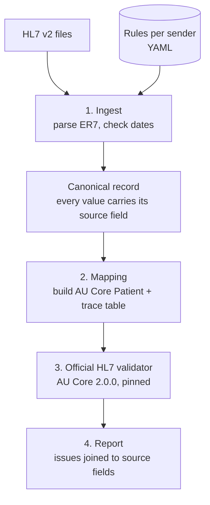

# AU Core Gateway

Converts HL7 v2 patient messages into Australia's national FHIR standard (**AU Core 2.0.0**),
validates every resource with the **official HL7 FHIR validator**, and traces every failure
back to the exact source field it came from.

> In August 2026 the Australian Digital Health Agency made AU Core the mandated baseline for
> FHIR connections to My Health Record. Most clinical systems still send HL7 v2. This project
> answers the question every vendor now has: *what does our data look like in AU Core, does it
> pass, and if not, exactly what is wrong and where?*

All data is synthetic. No real patient data or identifiers are used or accepted.

## What a run looks like

```
$ make demo
Records: 12   passed: 5   failed: 7
Issues:  10 errors, 12 could-not-check, 43 warnings, 11 info

  [FAIL] ihi-bad-check-digit-FAULT0001
         ihi-bad-check-digit.hl7:3 PID-3[1] inv-ihi-value-2: 'IHI shall pass the Luhn algorithm check'
  [FAIL] missing-birth-date-FAULT0003
         missing-birth-date.hl7:3 PID-7     Validation_VAL_Profile_Minimum: Patient.birthDate: minimum required = 1
  ...
  [PASS] clean-patients-GOLD0001
```

The error text is the validator's own. The `file:line FIELD` column is what this project adds:
the validator says `Patient.identifier[0]` is wrong, the gateway says *PID-3, repeat 1, line 3*.

## How it works



| Module | Owns | Never does |
| --- | --- | --- |
| `gateway/ingest/` | HL7 v2 parsing (repeats, escapes, MSH numbering), dates, rules-driven field extraction | Anything FHIR |
| `gateway/model/canonical.py` | The single shape passed between ingest and mapping | Logic |
| `gateway/mapping/` | AU Core Patient structure, identifier systems, trace table | Decide validity, or repair bad data |
| `gateway/validate/` | Run the validator once per batch, classify issues by message id | Add its own rules |
| `gateway/mapping/rules/*.yaml` | Which field holds what, code translations, per sender | — |

Issue categories: **error** (does not conform), **could-not-check** (the validator could not
evaluate a code because the Australian value set lives in NCTS, which needs registration; never
counted as a pass or a fail), **warning**, **info**.

## Testing: the fixtures are a contract

`scripts/make_fixtures.py` generates, from a fixed seed:

- **5 golden patients**, which must pass AU Core with zero errors
- **7 fault files**, each breaking exactly one thing, with the expected error and source field
  recorded in `fixtures/expectations.yaml`

| Fault | Expected error | Traced to |
| --- | --- | --- |
| IHI with a wrong check digit | `au-ihi#inv-ihi-value-2` | PID-3[1] |
| IHI in the HPI-I range (800361) | `au-ihi#inv-ihi-value-1` | PID-3[1] |
| Missing birth date | `Validation_VAL_Profile_Minimum` | PID-7 |
| 31 February | `ingest.bad-date` + missing birthDate | PID-7 |
| Missing sex | `Validation_VAL_Profile_Minimum` | PID-8 |
| Sex code `X` | `mapping.unmapped-code` + missing gender | PID-8 |
| No identifiers | `Validation_VAL_Profile_Minimum` + `au-core-pat-01` | PID-3 |

The integration tests run the real validator (never a mock) and require an **exact** match:
every expected error at the expected field, and no others. Checked failure modes: a one-character
typo in the IHI system URI fails 7 tests; one corrupted golden IHI fails 1.

## Quick start

Needs Python 3.11+ and Java 17+.

```bash
make setup      # Python deps, official validator, pinned FHIR packages
make test       # 40 unit tests, no Java, < 1 s
make validate   # 11 integration tests against the real validator, ~45 s
make demo       # run on all fixtures; full report in out/report.json
```

## Versions

Pinned in `versions.toml`: FHIR R4 4.0.1, AU Core 2.0.0, AU Base 6.0.0, validator recorded in
`tools/validator.version`. Terminology server: none (`-tx n/a`), so no sign-ups are needed.

## Decisions worth knowing

- **The validator is the only judge.** The gateway adds traceability and reporting, never its own
  conformance rules. Its pre-flight checks (dates, unmapped codes) are labelled `ingest.` and `mapping.`.
- **Bad data passes through unchanged.** Repairing an IHI would hide the problem the tool exists to find.
- **Partial dates stay partial.** `1980` never becomes `1980-01-01`.
- **MRNs use HPI-O scoped namespaces**, the Australian pattern, with a synthetic HPI-O. The first
  version used an `example.org` system; the validator rejected it, and AU Base turned out to
  require `assigner.display` on MRNs. Both fixes came from reading the profile, not guessing.

## Limits (honest scope)

- Phase 1 covers **Patient only**, from ADT^A04. Pathology results (ORU^R01 → Observation) are next.
- Australian value sets (states, IHI status, SNOMED CT-AU) are reported as *could-not-check*:
  checking them needs NCTS registration.
- Synthetic data only. Not certified, not for clinical use.
- The Dockerfile is written but has not yet been built and tested.

## Restricted networks

If `packages.fhir.org` is blocked, `make setup-offline` fetches packages from HL7's npm mirror
and fills unreachable dependency versions with stubs or the nearest release. Every substitution
is logged, flagged in the report, and refused by CI. Use it for development only.

## Roadmap

1. ✅ Phase 1: Patient pipeline, validator, fixtures, CI
2. Phase 2: Synthea → HL7 v2 exporter; ADT + ORU at 1,000 patients
3. Phase 3: Pathology result Observation, LOINC
4. Phase 4: Fault injector at scale, results store, drill-down dashboard
5. Phase 5: Write-up, demo video, measured numbers
