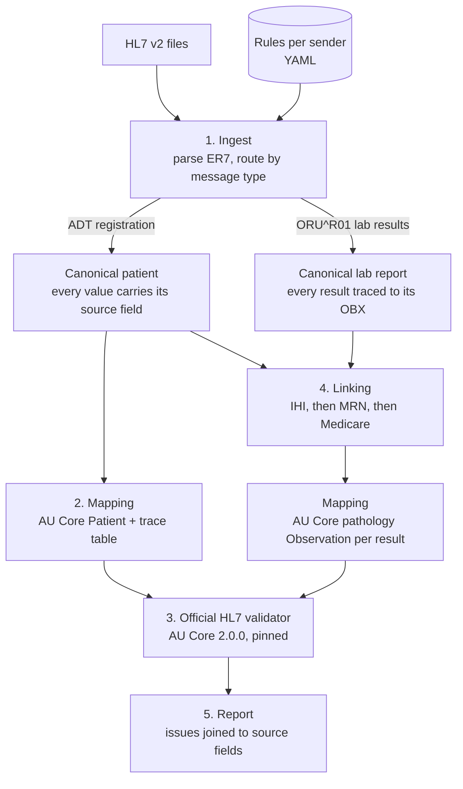

# AU Core Gateway

Converts HL7 v2 patient registrations and pathology results into Australia's national FHIR
standard (**AU Core 2.0.0** Patients and pathology Observations), validates them with the
**official HL7 FHIR validator**, links every lab result to the right patient, and traces every
failure back to the exact source field it came from. A seeded fault injector breaks a known
share of a 1,156-patient feed in ten known ways, and every break must be found at the right field.

> In August 2026 the Australian Digital Health Agency made AU Core the mandated baseline for
> FHIR connections to My Health Record. Most clinical systems still send HL7 v2. This project
> answers the question every vendor now has: *what does our data look like in AU Core, does it
> pass, and if not, exactly what is wrong and where?*

All data is synthetic. No real patient data or identifiers are used or accepted.

## What a run looks like

At scale, on a seeded population of synthetic Queensland patients (numbers from CI, on the
real HL7 packages):

```
$ python -m gateway run data/synthea-1000/adt data/synthea-1000/oru
Files: 24   records: 17189   passed: 17189   failed: 0
Patients:     1156/1156 conform to AU Core
Lab reports:  16033/16033 linked to a registered patient (384727 results, 0 orphans)
Observations: 384727 built, 2053 validated (175/175 result shapes; every shape + 5/1000 sample), 0 failed, 0 results not converted
Issues:       0 errors, 4803 could-not-check, 4679 warnings, 1156 info
Time:         28.4s ingest + mapping, 78.4s validation
```

On the test fixtures, where every failure is planted on purpose:

```
$ make demo
  [FAIL] ihi-bad-check-digit-FAULT0001
         ihi-bad-check-digit.hl7:3 PID-3[1]    inv-ihi-value-2: 'IHI shall pass the Luhn algorithm check'
  [FAIL] lab-non-numeric-value-FAULT0010
         lab-non-numeric-value.hl7:5 OBX(2)-5  ingest.bad-numeric: result type NM but value '6,1' is not a number
  [FAIL] lab-orphan-result-FAULT0008
         lab-orphan-result.hl7:2 PID-3         link.orphan-result: no registered patient matches this report's identifiers
  [FAIL] obs-unmapped-status-FAULT0016
         obs-unmapped-status.hl7:4 OBX(1)-11   Validation_VAL_Profile_Minimum: Observation.status: minimum required = 1, but only found 0 …
```

Validator error text is the validator's own. The `file:line FIELD` column is what this project
adds: the validator says `Patient.identifier[0]` is wrong, the gateway says *PID-3, repeat 1,
line 3*. `OBX(2)-5` means field 5 of the second result in the message.

## The dashboard

Every run can produce a single self-contained page (`--dashboard`, or `make demo`):

- **How the run flowed:** registrations and lab reports through each stage, with what dropped out where.
- **Issues by cause:** every issue type in plain language, grouped by severity, with records affected.
  Select a cause to list its records.
- **Record drill-down:** the HL7 message as received beside the AU Core resources produced (a
  Patient, or a lab report's Observations). Selecting an issue highlights the exact field
  (`PID-3[1]`, `OBX(2)-5`) on one side and the FHIR element on the other. Patients list their
  linked lab reports; lab reports link back to their patient.

The page displays the report and computes no verdicts of its own. At 17,000 records it stays near
2 MB by embedding full detail only for records with problems plus a sample of clean ones; every
count still covers the whole run. CI builds it on every push (artifact `dashboard`) and checks its
script with Node.

## How it works



| Module | Owns | Never does |
| --- | --- | --- |
| `gateway/ingest/` | HL7 v2 parsing (repeats, escapes, MSH numbering), ADT and ORU adapters, HL7 dates to ISO 8601 | Anything FHIR |
| `gateway/model/canonical.py` | The single shape passed between ingest and mapping | Logic |
| `gateway/mapping/` | AU Core Patient and pathology Observation structure, identifier systems, trace tables, exact decimals | Decide validity, repair bad data, or touch clinical values |
| `gateway/validate/` | Run the validator once per batch, classify issues by message id | Add its own rules |
| `gateway/pipeline.py` | Route messages, link lab reports to registered patients, build the report | Guess a patient |
| `gateway/identifiers/` | Check digits: IHI and Medicare (Luhn), LOINC (Mod 10) | Accept anything without a published source |
| `gateway/faults.py` | Score a run against the fault injector's ledger | Count a fault found at the wrong field |
| `gateway/store.py` | Every run in SQLite; error diff between runs | Decide anything |
| `gateway/dashboard/` | Turn a report into the dashboard page; plain-language issue labels | Decide anything |
| `gateway/mapping/rules/*.yaml` | Which field holds what, code translations, per sender | — |

Issue categories: **error** (does not conform), **could-not-check** (the validator could not
evaluate a code because the Australian value set lives in NCTS, which needs registration; never
counted as a pass or a fail), **warning**, **info**.

## Testing: the fixtures are a contract

`scripts/make_fixtures.py` generates, from a fixed seed:

- **5 golden patients and 2 golden lab reports**, which must pass with zero errors
- **16 fault files**, each breaking exactly one thing, with the expected error and source field
  recorded in `fixtures/expectations.yaml`

| Fault | Expected error | Traced to |
| --- | --- | --- |
| IHI with a wrong check digit | `au-ihi#inv-ihi-value-2` | PID-3[1] |
| IHI in the HPI-I range (800361) | `au-ihi#inv-ihi-value-1` | PID-3[1] |
| Missing birth date | `Validation_VAL_Profile_Minimum` | PID-7 |
| 31 February | `ingest.bad-date` + missing birthDate | PID-7 |
| Missing sex | `Validation_VAL_Profile_Minimum` | PID-8 |
| Sex code `X` | `mapping.unmapped-code` + missing gender | PID-8 |
| No identifiers | `Validation_VAL_Profile_Minimum` + `au-core-pat-01` | PID-3 |
| Lab report for an unregistered patient | `link.orphan-result` | PID-3 |
| Numeric result written `6,1` | `ingest.bad-numeric` | OBX(2)-5 |
| Result time in month 13 | `ingest.bad-datetime` | OBX(1)-14 |
| Result status `Z` | `mapping.unmapped-code` + missing `Observation.status` | OBX(1)-11 |
| Result coded in an unknown system (`XX`) | `mapping.unmapped-code` (code kept as text only) | OBX(1)-3.3 |
| Same IHI, different family name | warning `link.demographic-mismatch` (a person checks it) | PID-5[1].1 |
| IHI authority misspelt (`AUSHC`) | warning `ingest.unmapped-identifier`; the Patient still conforms, minus its IHI | PID-3[1] |
| Birth date written `02/04/1998` | `ingest.bad-date` + missing birthDate | PID-7 |
| LOINC `4548-5` (check digit wrong) | `ingest.bad-loinc-code` | OBX(1)-3 |

The integration tests run the real validator (never a mock) and require an **exact** match:
every expected error at the expected field, and no others. Checked failure modes: a one-character
typo in the IHI system URI fails 7 tests; one corrupted golden IHI fails 1.

## Pathology results as AU Core Observations

Each OBX becomes an `au-core-diagnosticresult-path` Observation for the linked patient:

| Observation | From | Rule |
| --- | --- | --- |
| `status` | OBX-11 | `F`/`P`/`C`/`X`/`D` translated by the sender's rules file; any other code is an error, never a guess |
| `category` | fixed | `laboratory` (the profile's required slice) |
| `code` | OBX-3 | LOINC when OBX-3.3 is `LN`; an unknown coding system keeps only the text and is flagged |
| `subject` | linking | the Patient the report was linked to |
| `effectiveDateTime` | OBX-14 | converted without inventing precision or a timezone |
| `valueQuantity` / `valueString` | OBX-2, -5, -6 | `NM` values keep their exact digits (`2.80` stays `2.80` in the JSON); UCUM units as sent |

Every result is converted. In small runs every Observation is validated; at population scale
the gateway validates **every distinct result shape** (code, value type, unit, status) plus a
deterministic sample, so each kind of result the feed contains is checked by the validator
without validating hundreds of thousands of near-identical resources. The report says which
mode ran and how many shapes were covered.

The validator's one recurring note at scale is a warning on Synthea's eGFR unit
`mL/min/{1.73_m2}`: UCUM annotations in braces are legal but discouraged. It is reported, and the
unit is left exactly as sent.

## Fault injection: proving detection, not assuming it

Clean data passing proves little. `scripts/inject_faults.py` takes the generated feed and breaks
25 messages per fault type (seeded, so the same messages every time), one fault per message, and
writes a ledger: which record, which field, the value before and after, and the issue the
gateway must raise. A fault counts as **found** only if its record carries that issue *at that
field*; the right error on the wrong field is a miss. Every other record is checked for false
alarms. Anything else a faulted record raises is accounted for too: a second report of the same
field counts as a *confirmation*, and a finding at any other field is *collateral*, which must be
zero.

| Fault | What changes | Must raise | Caught by |
| --- | --- | --- | --- |
| IHI check digit | last digit of PID-3[1] | `au-ihi#inv-ihi-value-2` | validator |
| IHI authority typo | `AUSHIC` written `AUSHC` | warning `ingest.unmapped-identifier` | ingest |
| Missing birth date | PID-7 emptied | `Validation_VAL_Profile_Minimum` | validator |
| Day-first birth date | `19960410` written `10/04/1996` | `ingest.bad-date` + `Validation_VAL_Profile_Minimum` | ingest and validator |
| Orphan result | PID-3 replaced by a never-registered person | `link.orphan-result` | linking |
| LOINC check digit | last digit of one OBX-3 | `ingest.bad-loinc-code` | ingest |
| Decimal comma | `92.7` written `92,7` in one NM result | `ingest.bad-numeric` | ingest |
| Impossible result time | month 13 in one OBX-14 | `ingest.bad-datetime` | ingest |
| Unknown result status | one OBX-11 `F` changed to `Z` | `mapping.unmapped-code` | mapping; validator confirms when it sees the Observation |
| Name mismatch | PID-5 family name changed | warning `link.demographic-mismatch` | linking |

No single layer catches everything. The validator raises an issue for four of the ten types; the
other six are caught only by the gateway's own checks on the HL7 before mapping (ingest) and on
patient identity after it (linking).

Every expected issue is one a hand-written fixture already proves (a test checks the two lists
agree). CI runs the faulted population on every push and fails unless every fault is found and
untouched records raise nothing:

```
$ make demo-faults
Faults:       250/250 injected faults detected at the right field; 0 false alarms on 16939 untouched records
Pass rate:    16939/16939 untouched records, 50/250 faulted records
```


All ten types were found 25 out of 25 times (numbers from CI, on the real HL7 packages). The 50
faulted records that still pass are the two warning-only types: the IHI authority typo and the
name mismatch, where the record is valid FHIR but a person needs to look.

Two findings came out of building this. A misspelt IHI authority produces a Patient that still
**conforms** (Medicare and MRN satisfy AU Core) but has silently lost its IHI; only the gateway's
warning shows it. And a registration with no birth date used to make every one of that patient's
lab reports warn "birth date differs from registered None"; linking now compares only values both
sides recorded.

The dashboard shows detection per fault type, and every faulted record opens with what was
changed, what was expected and whether it was found.

## Run history and error diffs

Every run is recorded in `out/history.db` (SQLite: runs, records, issues, fault outcomes; plain
SQL that would move to PostgreSQL unchanged). After changing a rule or an adapter:

```
$ python -m gateway diff
Run 1 -> run 2: 0 findings appeared, 0 resolved, 21 unchanged (errors and gateway warnings, by record, id and field)
```

Findings are matched on record, issue id and HL7 field, so an error that moves from PID-7 to
PID-8 shows as one resolved and one appeared. `gateway diff` exits 1 when anything appeared.
`python -m gateway history` lists runs; runs on substituted packages are flagged. A test checks
that the counts recomputed from the database equal the report's.

## Scale and round trip

`scripts/generate_population.py` runs **Synthea** (MITRE's synthetic patient generator, pinned to
v3.4.0 with a fixed seed and reference date) and `scripts/synthea_to_hl7.py` turns its output into
an Australian-style HL7 v2.4 feed:

- **Localised identity:** each patient gets a synthetic, format-valid IHI, Medicare number and MRN
  (correct prefixes and check digits), derived from their Synthea id so it never changes between
  runs, plus a Queensland suburb and postcode. Synthea's numeric name suffixes are removed.
- **Clinical content untouched:** results keep Synthea's LOINC codes, values and UCUM units.
  Units are **not** converted to Australian conventions (glucose stays mg/dL rather than mmol/L),
  and no reference ranges or abnormal flags are added, because changing or inventing clinical
  values is exactly what this project must never do.
- **Truth file:** the exporter records what every patient should look like after conversion.
- **Reproducible to the byte:** the exporter prints a SHA-256 fingerprint of the whole feed, and CI
  publishes its own. They match (`829d1184817222ef` for 1,000 patients). Getting there meant
  pinning Synthea's timezone and simulation end date: with the same seed, a machine on Brisbane
  time and a CI runner on UTC first produced 1,155 and 1,156 patients.

`make scale` (and CI, on every push to `main`) regenerates 1,000 living patients from scratch,
plus the patients Synthea simulates as having died, and checks that every patient conforms, every
lab report links, and the gateway's output **matches the Synthea source field by field**: names,
birth date, gender, and each patient's number of lab reports and results. It also checks that
every result became an Observation and every result shape was validated.

## Quick start

Needs Python 3.11+ and Java 17+.

```bash
make setup        # Python deps, official validator, pinned FHIR packages
make test         # 148 unit tests, no Java, < 1 s
make validate     # 30 integration tests against the real validator, ~2-3 min
make scale        # 1,000-patient Synthea population, end to end + round trip, ~4-5 min
make demo         # run on all fixtures; report and dashboard in out/
make demo-scale   # population + planted faults; dashboard in out/demo/
make demo-faults  # population with 250 injected faults; detection report + dashboard in out/faulted/
make history      # recorded runs; `python -m gateway diff` compares the last two over the same inputs
```

## Versions

Pinned in `versions.toml`: FHIR R4 4.0.1, AU Core 2.0.0, AU Base 6.0.0, HL7 validator 7.0.2,
Synthea v3.4.0 (seed 20261019). Terminology server: none (`-tx n/a`), so no sign-ups are needed.

## Decisions worth knowing

- **The validator is the only judge.** The gateway adds traceability and reporting, never its own
  conformance rules. Its pre-flight checks (dates, unmapped codes) are labelled `ingest.` and `mapping.`.
- **Bad data passes through unchanged.** Repairing an IHI would hide the problem the tool exists to find.
- **Partial dates stay partial, and timezones are never guessed.** `1980` never becomes
  `1980-01-01`; a result time without a timezone is kept as a date and flagged, because FHIR
  requires a timezone on any time and assuming one could shift a result to a different day.
- **Linking prefers the strongest identifier.** IHI first, then the lab's MRN, then Medicare.
  A report that matches nobody is rejected rather than attached to a best guess.
- **MRNs use HPI-O scoped namespaces**, the Australian pattern, with a synthetic HPI-O. The first
  version used an `example.org` system; the validator rejected it, and AU Base turned out to
  require `assigner.display` on MRNs. Both fixes came from reading the profile, not guessing.

## Limits (honest scope)

- Results are not grouped into a DiagnosticReport yet, and reference ranges and abnormal flags are
  not carried (the synthetic feed has none, and none are invented).
- A mistyped LOINC code is caught by its check digit, but a well-formed code that does not exist
  (right digit, unknown number) needs a terminology server to catch.
- With no terminology server, result codes are not checked against LOINC or the Australian
  pathology value set (SPIA, which needs NCTS), and units are not checked against UCUM. The
  validator says so on each Observation, and those notes are counted as *could-not-check*.
- At population scale Observations are validated by shape plus a sample, not one by one (see above).
- Synthea's demographics are American; identity and addresses are localised, but disease patterns
  and units are not Australian.
- Australian value sets (states, IHI status, SNOMED CT-AU) are reported as *could-not-check*:
  checking them needs NCTS registration.
- Synthetic data only. Not certified, not for clinical use.
- The Dockerfile is written but has not yet been built and tested.

## Restricted networks

If `packages.fhir.org` is blocked, `make setup-offline` fetches packages from HL7's npm mirror
and fills unreachable dependency versions with stubs or the nearest release. Every substitution
is logged, flagged in the report, and refused by CI. Use it for development only.

## Roadmap

1. ✅ Phase 1: Patient pipeline, validator, fixtures, CI
2. ✅ Phase 2: Synthea → HL7 v2 exporter; ADT + ORU at 1,000 patients, linking, round trip
3. ✅ Phase 3: Pathology result Observations (LOINC, UCUM), every result shape validated
4. ✅ Phase 4: Fault injector at scale (10 types, detection measured per type), results store and error diffs, drill-down dashboard
5. Phase 5: Write-up, demo video, measured numbers
