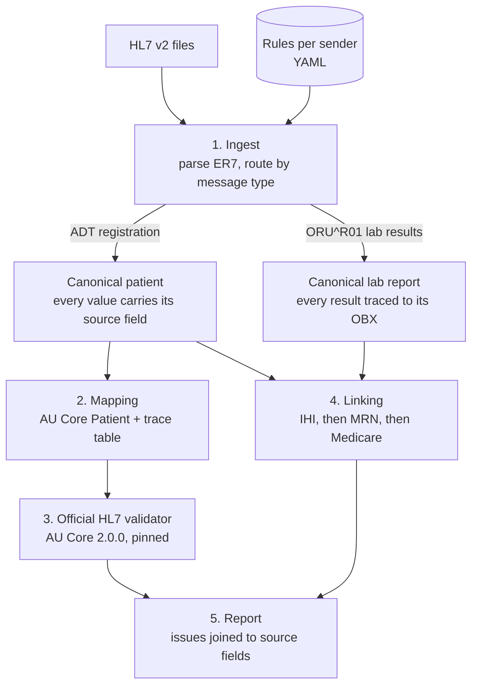

# AU Core Gateway

Converts HL7 v2 patient registrations into Australia's national FHIR standard (**AU Core 2.0.0**),
validates every resource with the **official HL7 FHIR validator**, links every lab result to the
right patient, and traces every failure back to the exact source field it came from.

> In August 2026 the Australian Digital Health Agency made AU Core the mandated baseline for
> FHIR connections to My Health Record. Most clinical systems still send HL7 v2. This project
> answers the question every vendor now has: *what does our data look like in AU Core, does it
> pass, and if not, exactly what is wrong and where?*

All data is synthetic. No real patient data or identifiers are used or accepted.

## What a run looks like

At scale, on a seeded population of synthetic Queensland patients (numbers from CI, on the
real HL7 packages):

```
$ make demo-scale
Files: 24   records: 17189   passed: 17189   failed: 0
Patients:    1156/1156 conform to AU Core
Lab reports: 16033/16033 linked to a registered patient (384727 results, 0 orphans)
Issues:      0 errors, 1156 could-not-check, 4624 warnings, 1156 info
Time:        16.6s ingest + mapping, 39.5s validation + linking
```

On the test fixtures, where every failure is planted on purpose:

```
$ make demo
  [FAIL] ihi-bad-check-digit-FAULT0001
         ihi-bad-check-digit.hl7:3 PID-3[1]    inv-ihi-value-2: 'IHI shall pass the Luhn algorithm check'
  [FAIL] lab-non-numeric-value-FAULT0010
         lab-non-numeric-value.hl7:5 OBX(2)-5  ingest.bad-numeric: result type NM but value '6,1' is not a number
  [FAIL] lab-orphan-result-FAULT0008
         lab-orphan-result.hl7:2 PID-3         link.orphan-result: no registered patient matches this report's identifiers
```

Validator error text is the validator's own. The `file:line FIELD` column is what this project
adds: the validator says `Patient.identifier[0]` is wrong, the gateway says *PID-3, repeat 1,
line 3*. `OBX(2)-5` means field 5 of the second result in the message.

## The dashboard

Every run can produce a single self-contained page (`--dashboard`, or `make demo`):

- **How the run flowed:** registrations and lab reports through each stage, with what dropped out where.
- **Issues by cause:** every issue type in plain language, grouped by severity, with records affected.
  Select a cause to list its records.
- **Record drill-down:** the HL7 message as received beside the AU Core resource produced. Selecting an
  issue highlights the exact field (`PID-3[1]`, `OBX(2)-5`) on one side and the FHIR element on the
  other. Patients list their linked lab reports; lab reports link back to their patient.

The page displays the report and computes no verdicts of its own. At 17,000 records it stays near
2 MB by embedding full detail only for records with problems plus a sample of clean ones; every
count still covers the whole run. CI builds it on every push (artifact `dashboard`) and checks its
script with Node.

## How it works



| Module | Owns | Never does |
| --- | --- | --- |
| `gateway/ingest/` | HL7 v2 parsing (repeats, escapes, MSH numbering), ADT and ORU adapters, HL7 dates to ISO 8601 | Anything FHIR |
| `gateway/model/canonical.py` | The single shape passed between ingest and mapping | Logic |
| `gateway/mapping/` | AU Core Patient structure, identifier systems, trace table | Decide validity, or repair bad data |
| `gateway/validate/` | Run the validator once per batch, classify issues by message id | Add its own rules |
| `gateway/pipeline.py` | Route messages, link lab reports to registered patients, build the report | Guess a patient |
| `gateway/dashboard/` | Turn a report into the dashboard page; plain-language issue labels | Decide anything |
| `gateway/mapping/rules/*.yaml` | Which field holds what, code translations, per sender | — |

Issue categories: **error** (does not conform), **could-not-check** (the validator could not
evaluate a code because the Australian value set lives in NCTS, which needs registration; never
counted as a pass or a fail), **warning**, **info**.

## Testing: the fixtures are a contract

`scripts/make_fixtures.py` generates, from a fixed seed:

- **5 golden patients and 2 golden lab reports**, which must pass with zero errors
- **11 fault files**, each breaking exactly one thing, with the expected error and source field
  recorded in `fixtures/expectations.yaml`

| Fault | Expected error | Traced to |
| --- | --- | --- |
| IHI with a wrong check digit | `au-ihi#inv-ihi-value-2` | PID-3[1] |
| IHI in the HPI-I range (800361) | `au-ihi#inv-ihi-value-1` | PID-3[1] |
| Missing birth date | `Validation_VAL_Profile_Minimum` | PID-7 |
| 31 February | `ingest.bad-date` + missing birthDate | PID-7 |
| Missing sex | `Validation_VAL_Profile_Minimum` | PID-8 |
| Sex code `X` | `mapping.unmapped-code` + missing gender | PID-8 |
| No identifiers | `Validation_VAL_Profile_Minimum` + `au-core-pat-01` | PID-3 |
| Lab report for an unregistered patient | `link.orphan-result` | PID-3 |
| Numeric result written `6,1` | `ingest.bad-numeric` | OBX(2)-5 |
| Result time in month 13 | `ingest.bad-datetime` | OBX(1)-14 |
| Same IHI, different family name | warning `link.demographic-mismatch` (a person checks it) | PID-5[1].1 |

The integration tests run the real validator (never a mock) and require an **exact** match:
every expected error at the expected field, and no others. Checked failure modes: a one-character
typo in the IHI system URI fails 7 tests; one corrupted golden IHI fails 1.

## Scale and round trip

`scripts/generate_population.py` runs **Synthea** (MITRE's synthetic patient generator, pinned to
v3.4.0 with a fixed seed and reference date) and `scripts/synthea_to_hl7.py` turns its output into
an Australian-style HL7 v2.4 feed:

- **Localised identity:** each patient gets a synthetic, format-valid IHI, Medicare number and MRN
  (correct prefixes and check digits), derived from their Synthea id so it never changes between
  runs, plus a Queensland suburb and postcode. Synthea's numeric name suffixes are removed.
- **Clinical content untouched:** results keep Synthea's LOINC codes, values and UCUM units.
  Units are **not** converted to Australian conventions (glucose stays mg/dL rather than mmol/L),
  and no reference ranges or abnormal flags are added, because changing or inventing clinical
  values is exactly what this project must never do.
- **Truth file:** the exporter records what every patient should look like after conversion.
- **Reproducible to the byte:** the exporter prints a SHA-256 fingerprint of the whole feed, and CI
  publishes its own. They match (`829d1184817222ef` for 1,000 patients). Getting there meant
  pinning Synthea's timezone and simulation end date: with the same seed, a machine on Brisbane
  time and a CI runner on UTC first produced 1,155 and 1,156 patients.

`make scale` (and CI, on every push to `main`) regenerates 1,000 living patients from scratch,
plus the patients Synthea simulates as having died, and checks that every patient conforms, every
lab report links, and the gateway's output **matches the Synthea source field by field**: names,
birth date, gender, and each patient's number of lab reports and results.

## Quick start

Needs Python 3.11+ and Java 17+.

```bash
make setup        # Python deps, official validator, pinned FHIR packages
make test         # 85 unit tests, no Java, < 1 s
make validate     # 17 integration tests against the real validator, ~45 s
make scale        # 1,000-patient Synthea population, end to end + round trip, ~4-5 min
make demo         # run on all fixtures; report and dashboard in out/
make demo-scale   # population + planted faults; dashboard in out/demo/
```

## Versions

Pinned in `versions.toml`: FHIR R4 4.0.1, AU Core 2.0.0, AU Base 6.0.0, HL7 validator 7.0.2,
Synthea v3.4.0 (seed 20261019). Terminology server: none (`-tx n/a`), so no sign-ups are needed.

## Decisions worth knowing

- **The validator is the only judge.** The gateway adds traceability and reporting, never its own
  conformance rules. Its pre-flight checks (dates, unmapped codes) are labelled `ingest.` and `mapping.`.
- **Bad data passes through unchanged.** Repairing an IHI would hide the problem the tool exists to find.
- **Partial dates stay partial, and timezones are never guessed.** `1980` never becomes
  `1980-01-01`; a result time without a timezone is kept as a date and flagged, because FHIR
  requires a timezone on any time and assuming one could shift a result to a different day.
- **Linking prefers the strongest identifier.** IHI first, then the lab's MRN, then Medicare.
  A report that matches nobody is rejected rather than attached to a best guess.
- **MRNs use HPI-O scoped namespaces**, the Australian pattern, with a synthetic HPI-O. The first
  version used an `example.org` system; the validator rejected it, and AU Base turned out to
  require `assigner.display` on MRNs. Both fixes came from reading the profile, not guessing.

## Limits (honest scope)

- Lab results are parsed, checked and linked, but **not yet converted to FHIR Observations**
  (Phase 3). Only Patients are validated against AU Core so far.
- Synthea's demographics are American; identity and addresses are localised, but disease patterns
  and units are not Australian.
- Australian value sets (states, IHI status, SNOMED CT-AU) are reported as *could-not-check*:
  checking them needs NCTS registration.
- Synthetic data only. Not certified, not for clinical use.
- The Dockerfile is written but has not yet been built and tested.

## Restricted networks

If `packages.fhir.org` is blocked, `make setup-offline` fetches packages from HL7's npm mirror
and fills unreachable dependency versions with stubs or the nearest release. Every substitution
is logged, flagged in the report, and refused by CI. Use it for development only.

## Roadmap

1. ✅ Phase 1: Patient pipeline, validator, fixtures, CI
2. ✅ Phase 2: Synthea → HL7 v2 exporter; ADT + ORU at 1,000 patients, linking, round trip
3. Phase 3: Pathology result Observation, LOINC
4. Phase 4: Fault injector at scale, results store, drill-down dashboard
5. Phase 5: Write-up, demo video, measured numbers
