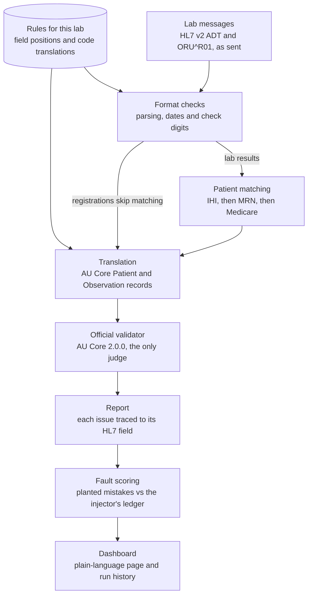

# AU Core Gateway: project write-up

Dylan Chand · October 2026

## Summary

AU Core Gateway takes the HL7 v2 messages a pathology lab sends and turns them into Australia's national FHIR standard, AU Core 2.0.0. The official HL7 FHIR validator checks every record. The gateway files each result against the right patient and traces every problem back to the exact field in the lab's original message.

On a reproducible population of 1,156 synthetic Queensland patients, every patient record and all 384,727 test results pass the official validator. Every lab report is linked to the right patient. To prove the checks work, a fault injector plants 250 realistic mistakes. The gateway finds all 250 at the exact field that was changed, with no false alarms on the 16,939 records left untouched.

It is released as [v1.1.0](https://github.com/dylandchand/au-core-gateway/releases/latest), with a [live dashboard](https://dylandchand.github.io/au-core-gateway/) written for non-technical readers.

## The problem

Australia is moving My Health Record onto FHIR, while most clinical systems still speak HL7 v2. In August 2026 the Australian Digital Health Agency made AU Core and AU CDI the national baseline for FHIR connections to My Health Record. Its indicative timetable ends with existing CDA connections retired by mid-2029, and pathology may move earlier ([Medical Republic](https://medicalrepublic.com.au/adha-to-mandate-national-interoperability-standards-for-my-health-record/128099), [AJP](https://ajp.com.au/news/national-interoperability-baseline-for-digital-health/)).

HL7 v2 is a pipe-delimited text format from the late 1980s. A registration (ADT) message carries a patient's identity, and a result (ORU^R01) message carries their test results. AU Core is a set of FHIR profiles that say exactly what a valid Australian Patient or pathology Observation must contain.

The translation between the two is where things go wrong:

- **Identity.** A mistyped digit in an Individual Healthcare Identifier (IHI) makes a record unusable or, worse, points it at someone else.
- **Dates.** A birth date written day-first (`02/04/1998`) is not an HL7 date, and silently guessing what it means is a clinical risk.
- **Results.** A value written with a decimal comma, a status code the standard does not know, or a result filed against the wrong patient all corrupt the record.

Every vendor connecting to My Health Record now has the same question: what does our data look like in AU Core, does it pass, and if not, exactly what is wrong and where? This project answers that question for a pathology feed.

## What I built

The gateway is a Python pipeline that reads a lab's HL7 v2 files and produces AU Core records, a JSON report and a dashboard. Each stage owns one job and never does the next stage's.

A lab message is parsed and checked for format problems first: dates, numbers, and the check digits of IHI, Medicare and LOINC codes. Result messages are then matched to a registered patient. Translation turns each registration into an AU Core Patient and each result into an AU Core pathology Observation, guided by a rules file for that lab (27 rules for the demo lab). The official validator then checks every record. Because each value carries the HL7 field it came from, every issue in the report points back to the lab's original message.

| Module | Owns | Never does |
| --- | --- | --- |
| Ingest | HL7 v2 parsing, registration and result adapters, HL7 dates | Anything FHIR |
| Canonical model | The single shape passed from ingest to translation | Logic |
| Mapping | AU Core Patient and Observation, identifier systems, field traces, exact decimals | Decide validity, repair data, or change clinical values |
| Identifiers | Check digits for IHI (Luhn), Medicare (weighted mod 10), LOINC (Mod 10) | Anything without a published source |
| Validate | Runs the official validator in batches and sorts its issues | Add rules of its own |
| Pipeline | Routes messages, links results to patients, chooses what to validate | Guess a patient |
| Faults, store, dashboard | Score the fault test, record every run, display the report | Decide pass or fail |

## Design decisions

Every rule below exists so that the gateway reports the truth about the data, instead of making the data look better than it is.

| Decision | Why |
| --- | --- |
| The official HL7 validator is the only judge of conformance | A home-made checker can agree with itself and still be wrong. The gateway adds traceability and clearly labelled pre-flight checks (`ingest.`, `mapping.`, `link.`), never conformance rules of its own. |
| Bad data passes through unchanged, or is reported and left out | Repairing an IHI, guessing a status or keeping half a result would hide the exact problem the tool exists to find. A bad IHI is emitted as received so the validator reports it. |
| Partial dates stay partial; timezones are never guessed | `1980` never becomes `1980-01-01`. Invented precision is invented data. |
| Clinical content is never altered | No unit conversion, invented reference ranges or abnormal flags. Decimals keep the digits as received: `2.80` stays `2.80`. |
| Rules translate only what the sender sent | A blank field gets no default country, name type or address type. An unknown status or coding system is flagged as `mapping.unmapped-code`, never guessed. |
| Linking prefers the strongest identifier | IHI, then the lab's MRN, then Medicare. A report that matches nobody is an error, never attached to a best guess. A match with a different name or birth date is a warning, because the identifier is still the stronger evidence. |
| Every finding points at an HL7 field | Each value carries the field it came from (`PID-3[1]`, `OBX(2)-5`), so a validator error on `Patient.identifier[0]` becomes "PID-3, first repeat, line 3". |
| Versions are pinned in one file | FHIR 4.0.1, AU Core 2.0.0, AU Base 6.0.0, validator 7.0.2 and Synthea v3.4.0 live only in `versions.toml`. A newer validator can add checks, so results change only when that file does. |

Two fixes came straight from reading the profiles rather than from memory. MRNs use an HPI-O scoped namespace, because the validator rejected an `example.org` system. AU Base also requires `assigner.display` on MRNs.

## How it is tested

The project is built so that a passing result has to be earned against the real validator, and a broken check cannot hide.

**Fixtures are a contract.** A script generates, from a fixed seed, 2 golden files (5 patients, 2 lab reports) that must pass with zero errors, and 17 fault files that each break exactly one thing. An expectations file records the exact error and HL7 field each one must produce. The integration tests run the real validator, never a mock, and require an exact match: every expected error at its field, and nothing else. Expectations change only when the spec says so, never to make a test pass.

**Planted mistakes at scale.** A seeded fault injector breaks 25 messages for each of ten kinds of mistake, one mistake per message, and writes a ledger of every change. A mistake counts as found only when the right issue appears at the field that was changed. Anything else is accounted for: another report of the same field is a confirmation, a finding at any other field is collateral and must be zero, and any finding on an untouched record is a false alarm. Each kind's expected issue must be one its hand-written fixture already proves, and a test enforces that.

| Planted mistake | Caught by |
| --- | --- |
| Last digit of the IHI changed | official validator |
| IHI authority misspelt | format checks |
| Birth date removed | official validator |
| Birth date written day-first | format checks and official validator |
| Lab report for a never-registered person | patient matching |
| One result's LOINC check digit changed | format checks |
| One numeric result written with a decimal comma | format checks |
| One result time set to month 13 | format checks |
| One result status `F` changed to `Z` | translation rules, confirmed by the validator |
| Family name differs from the registration | patient matching |

The validator catches four of the ten kinds on its own. The other six need the gateway's own checks, which is why they exist.

**Check digits from published sources.** IHI (Luhn), Medicare (weighted mod 10) and LOINC (Mod 10) are each tested against published examples. LOINC is tested against the 14 mismatched codes in the LOINC Users' Guide.

**Continuous integration.** On every push, GitHub Actions runs 180 unit tests, 32 integration tests against the validator, and a clean-clone Docker build that must reproduce the fixture expectations exactly. Every push to main also runs the full synthetic population (1,156 patients) with the fault test, then publishes the dashboard. A weekly workflow validates every one of the 384,727 Observations individually. CI refuses any run that used stand-in packages, so no published number comes from a substituted run.

**Reproducible to the byte.** Synthea (MITRE's synthetic patient generator) runs with a fixed seed, timezone and end date. CI and a local machine produce the same feed fingerprint (`6726ab5d912f2385`, and `f25ac3c38941e366` for the faulted copy).

**Run history.** Every run is stored in SQLite. After a rule changes, `python -m gateway diff` lists the findings that appeared or were resolved, and exits with an error if anything new appeared.

**Independent review.** A reviewer that had no part in writing the code found 13 issues, including one that cut multi-part result values short. All 13 were verified and fixed, and every code fix has a test.

## Results

Every record in the clean population conforms to AU Core, and every planted mistake is found at its field. All figures are measured in CI on the real HL7 packages, over 1,156 synthetic Queensland patients.

| Measure | Result |
| --- | --- |
| Patient registrations that conform to AU Core | 1,156 of 1,156 |
| Lab reports filed against the right patient | 16,033 of 16,033 |
| Test results translated into AU Core Observations | 384,727, all passing the official validator |
| Planted mistakes found at the exact field | 250 of 250 (10 kinds × 25) |
| False alarms on untouched records | 0 of 16,939 |
| Findings outside the changed fields | 0 |
| Time for the whole population | 25 s to read and translate, 71 s to validate (push-to-main run) |
| Full validation of every Observation | 1 hour 45 minutes (weekly run) |

On each push to main, the validator checks every distinct kind of result (test, value type, unit, status and time precision: 175 kinds) plus a fixed sample, 2,053 Observations in all. The weekly run checks all 384,727 one by one.

The run also reports 4,846 "could not check" items and 4,722 warnings, kept as reported rather than hidden. "Could not check" means the validator needs a terminology server to confirm a code, so these count as neither a pass nor a fail. The warnings are the validator's general notes, such as an identifier that fits more than one profile.

## The dashboard

Every run can write one self-contained web page that explains the result to someone who has never seen HL7 or FHIR. The [public copy](https://dylandchand.github.io/au-core-gateway/) is rebuilt by CI on each push to main.

- **The problem first.** The page opens by asking whether this run's lab data meets Australia's national health record standard. Next to the question, a real registration line from the run sits beside the AU Core record it became, with numbered markers linking each detail to its source.
- **The run at a glance.** A scorecard shows the headline numbers, and a pipeline view shows where messages dropped out at each step.
- **The fault test.** A matrix shows which check caught each kind of planted mistake.
- **The built-in examples.** When a run includes the project's example files, the page lists each one in plain words with the problem it must trigger, where, and whether it did. The list is checked against the recorded expectations with the same rule as the automated tests, and the default demo opens with a note saying its failures are deliberate.
- **Every record, side by side.** Any record opens with what the lab sent next to what the gateway produced, each problem highlighted at its field in both.
- **Plain language.** Words with a dotted underline open short definitions, and a glossary collects them. A "Technical detail" switch adds validator ids, FHIR paths and HL7 locators for developers.

The public page shows the fault-test run, so some records fail on purpose. A note above the headline numbers says so, with the result for untouched records. The dashboard only displays the report: it holds no pass/fail logic, and every number on it comes from the run's own report.

## The Message Inspector

The [Message Inspector](https://dylandchand.github.io/au-core-gateway/inspector/) lets anyone pick a built-in example or paste a message and watch the gateway translate it, field by field, in their own browser. It runs the project's unchanged Python code on Pyodide, so nothing pasted is uploaded. Pointing at a value on either side lights up its counterpart: a birth date `19860315` in PID-7 becomes `"1986-03-15"` in `Patient.birthDate`.

The official validator is a Java program and cannot run in a browser. The page shows the gateway's own checks and, for unchanged built-in examples, what the validator found in the CI run that built the page. CI also checks that every example gives exactly the command line's results inside Pyodide.

## The Interface Monitor

Converting messages is half of running an interface; the other half is noticing when it stops working. The [Interface Monitor](https://dylandchand.github.io/au-core-gateway/monitor/) plays a synthetic lab feed through the gateway one message at a time, and the gateway answers each with an HL7 acknowledgement: `AA` accepted, `AE` error or `AR` rejected. A lab report is accepted only once its patient's registration has arrived, as on a real interface.

The feed always contains one planted message for each kind of mistake the gateway catches itself, taken from the fault ledger, plus one unsupported message type; each is marked "planted", and everything else is clean. The detail panel follows the feed live and highlights the field each problem points to.

Visitors can also stage faults. Six are messages that go through the real code (a lab report for an unregistered patient, a decimal comma, a mistyped LOINC code, an unknown status code, a message type the interface does not handle, and a mistyped IHI). Two are network faults simulated in the page, because nothing real can be disconnected there: the sender cannot reach the gateway, and a connection that drops part-way through a message. Each fault lists the checks a support person would work through.

The mistyped IHI is the instructive one. The gateway acknowledges it `AA`, because an interface acknowledges on its own checks, and the official validator then rejects the IHI's check digit. A green ACK means "received and read", not "correct".

The same code runs as a real listener on the user's own computer: `python -m gateway listen` receives HL7 v2 over MLLP on `127.0.0.1:2575`, and `python -m gateway send` sends files to it. CI replays the page's feed in Pyodide and on the command line and requires every ACK to be identical.

## Limits

The gateway proves conformance for one sender's synthetic pathology feed. It is not certified and not for clinical use.

- **No terminology server.** Codes are not checked against LOINC, UCUM or the Australian value sets in NCTS, which needs registration. A mistyped LOINC code is caught by its check digit, but a well-formed code that does not exist is not. These are counted as "could not check".
- **Results stand alone.** They are not grouped into a pathology report. Reference ranges and abnormal flags are not carried, because the synthetic feed has none and none are invented.
- **Some value types are reported, not translated.** A coded value written in several parts (such as CE/CWE) or a repeated value is reported as an error and not converted, rather than cut down to one part.
- **Synthetic, partly localised data.** Synthea's demographics are American. Identity and addresses are localised to Queensland, while disease patterns and units are not.
- **One sender.** The rules file covers one demo lab. A second lab means a second rules file, not code changes, but that has not been tested against a real sender's quirks.
- **Full validation is weekly.** Pushes validate every kind of result plus a sample, and the weekly run checks every Observation.

## What I would do next

Each next step closes one of the limits above, in order of what a real deployment would need first.

1. **Connect a terminology server.** Register with NCTS and point the validator at it, so the 4,846 "could not check" items become real passes or failures.
2. **Group results into pathology reports.** Build an AU Base pathology report (`au-pathologyreport`) per lab report, so results reach My Health Record the way a clinician reads them. AU Core 2.0.0 itself has no DiagnosticReport profile.
3. **Support coded and multi-part values.** Translate CE/CWE results into `valueCodeableConcept`, using rules per sender rather than guesses.
4. **Test a second sender.** Write a second rules file from a different lab's message conventions, to prove the rules approach holds without code changes.
5. **Track AU Core releases.** Re-run the fixtures against the next published AU Core version and report what changes, using the run history's diff.

## Stack, links and how to run it

| | |
| --- | --- |
| Code | [github.com/dylandchand/au-core-gateway](https://github.com/dylandchand/au-core-gateway) |
| Release | [Latest release](https://github.com/dylandchand/au-core-gateway/releases/latest) |
| Live dashboard | [dylandchand.github.io/au-core-gateway](https://dylandchand.github.io/au-core-gateway/) |
| Message Inspector | [dylandchand.github.io/au-core-gateway/inspector](https://dylandchand.github.io/au-core-gateway/inspector/) |
| Interface Monitor | [dylandchand.github.io/au-core-gateway/monitor](https://dylandchand.github.io/au-core-gateway/monitor/) |
| Language | Python 3.11+, with the official HL7 FHIR validator 7.0.2 (Java 17+) |
| Standards | HL7 v2.4 (ADT, ORU^R01), FHIR R4 4.0.1, AU Core 2.0.0, AU Base 6.0.0 |
| Data | Synthea v3.4.0, fixed seed 20261019, exported to HL7 v2 with Australian identifiers |
| Storage | SQLite run history |
| Delivery | GitHub Actions, Docker, GitHub Pages |

To run it with Docker, use `docker compose up --build`. It writes a report and a dashboard to `out/`. With Python and Java installed, `make setup && make demo` does the same, and `make scale` generates the full population and runs it with the fault test in about six minutes.

The project was built with Claude Code, Anthropic's AI coding agent, working to a written set of project rules ([`CLAUDE.md`](../CLAUDE.md)) that fix the versions, forbid invented codes and identifiers, and make the tests a contract.

All data is synthetic: no real patient data is used. IHIs and Medicare numbers are generated at random in the real format, so one may match an issued number by chance, but it is only ever paired with fictional details and never refers to that person. Do not run real patient data through this project.

This material contains content from LOINC (<http://loinc.org>). LOINC is copyright © Regenstrief Institute, Inc. and the Logical Observation Identifiers Names and Codes (LOINC) Committee and is available at no cost under the license at <http://loinc.org/license>. LOINC® is a registered United States trademark of Regenstrief Institute, Inc. FHIR® is the registered trademark of HL7 and is used with the permission of HL7. HL7® is a registered trademark of Health Level Seven International. This project is not affiliated with, or approved or sponsored by, HL7, HL7 Australia, the Australian Digital Health Agency, Services Australia, Regenstrief Institute or MITRE.

## Sources

- [ADHA to mandate interoperability standards for My Health Record (report)](https://medicalrepublic.com.au/adha-to-mandate-national-interoperability-standards-for-my-health-record/128099), The Medical Republic, 12 August 2026
- [National interoperability baseline (news item)](https://ajp.com.au/news/national-interoperability-baseline-for-digital-health/), AJP, 7 August 2026
